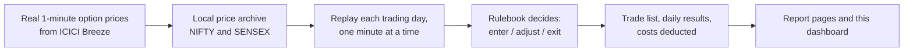

# Options Strategy Report Dashboard

**What this is, in one paragraph.** Nine rule-based ways of trading Indian stock-market *index options* (NIFTY and SENSEX), each tested on real minute-by-minute price history, and the results published as a website you can click through. A "strategy" here is just a written rulebook: *at 09:30 do this, if the price moves this far do that, at 15:25 close everything.* A computer follows the rulebook over every trading day since January 2026 and records exactly what would have happened. Nothing here places a real trade.

**Open the dashboard:** <https://options-strategy-reports.vercel.app>

> **Please read this first.** This is a research and learning project. It shows what a rulebook *would have done in the past*. It is **not** investment advice, **not** a recommendation to trade, and **not** a forecast. The past ~9 months are one small slice of market history, and a rulebook that did well on that slice can lose money on the next one. See [What you should and should not conclude](#7-what-you-should-and-should-not-conclude).

---

## Contents

1. [Start here: no finance background needed](#1-start-here-no-finance-background-needed)
2. [The nine strategies, in plain English](#2-the-nine-strategies-in-plain-english)
3. [How a test (a "backtest") works](#3-how-a-test-a-backtest-works)
4. [How to read the dashboard](#4-how-to-read-the-dashboard)
5. [How to read a report page](#5-how-to-read-a-report-page)
6. [Paper trading ("forward tests") and the Live page](#6-paper-trading-forward-tests-and-the-live-page)
7. [What you should and should not conclude](#7-what-you-should-and-should-not-conclude)
8. [Glossary](#8-glossary)
9. [What is in this repository](#9-what-is-in-this-repository)

---

## 1. Start here: no finance background needed

### What is an option?

An **option** is a contract that gives someone the *right*, but not the obligation, to buy or sell something at a fixed price before a fixed date.

- A **call** option pays off if the market goes **up**.
- A **put** option pays off if the market goes **down**.
- The fixed price is called the **strike**.
- The price you pay for the contract is called the **premium**.
- The date it stops existing is the **expiry**. Weekly options on **NIFTY** expire every Tuesday and weekly options on **SENSEX** every Thursday.

**NIFTY** and **SENSEX** are the two main Indian stock-market indices (a single number that summarises the price of a basket of big companies). The options in this project are options *on those indices*.

### Buying versus selling

Every option has two sides: a buyer and a seller. This project is about the **seller**.

- The buyer pays the premium up front and hopes for a big move.
- The seller **collects** the premium up front and hopes **nothing dramatic happens**. Every minute that passes, the contract loses a bit of value (this is called **time decay**), and the seller keeps the difference.

A rough analogy (it is only an analogy): the seller behaves a little like an insurance company. It collects many small payments, most of which it keeps, and it occasionally has to pay out a large claim. Selling options works the same way: lots of small wins, and now and then a big loss when the market moves sharply. That shape of risk is the single most important thing to understand about every strategy on this page.

### The vocabulary the strategies use

| Word | Plain meaning |
|---|---|
| **Straddle** | Sell a call and a put at the *same* strike at the same time. You win if the market stays put, you lose if it moves a lot in either direction. |
| **ATM** ("at the money") | The strike closest to where the index is trading right now. |
| **OTM** ("out of the money") | A strike further away from the current price. "OTM5" means five strikes away. |
| **Stop-loss** | A pre-set rule: "if this position has lost this much, close it." |
| **Target** | A pre-set rule: "if this position has made this much, close it and bank the win." |
| **Lot** | Options are sold in fixed bundles. One NIFTY lot is 65 units and one SENSEX lot is 20 units. "5 lots" means five bundles. |
| **DTE** ("days to expiry") | How many *trading* days are left before the contract expires. **DTE 0** is expiry day itself, DTE 1 is the trading day before, and so on up to DTE 4. |
| **Open interest (OI)** | How many contracts of a given strike are currently open. A busy strike has high OI. |

---

## 2. The nine strategies, in plain English

All nine are **intraday**: they open and close positions within a single day and are flat by mid-afternoon. All of them **sell** options. Stop-loss and target amounts are stated for **1 lot** and scale up if you trade more lots.

| # | Strategy | Index | The one-sentence idea | When it trades |
|---|---|---|---|---|
| 1 | **1 Hour Straddles** | NIFTY | Sell a fresh at-the-money straddle every hour and let time decay pay you. | Six entries, 09:30 to 14:30; flat by 15:25 |
| 2 | **NF ATM Straddle Recentre** | NIFTY | Stay short one straddle all day; whenever it has bounced 15% off its best level, close it and sell a new one at the current price. | From 09:20; flat by 15:05 |
| 3 | **NF OI Recentre** | NIFTY | Sell the call and the put at the strikes where most other traders have positions, and move each one when a different strike takes the lead. | From 10:00; flat by 14:40 |
| 4 | **NF Shifting Master** | NIFTY | Sell a ladder of three calls above and three puts below the market, and slide the ladder to keep a fixed distance as the market moves. | From 09:20; flat by 15:10 |
| 5 | **Sensex Shifting Master** | SENSEX | The same ladder idea on SENSEX, with its own loss limit. | From 09:20; flat by 15:10 |
| 6 | **Market Mover NF** | NIFTY | Sell one call and one put well away from the market; leave alone the side the market is walking toward, and move the other side back out. | From 09:19; flat by 15:10 |
| 7 | **Market Mover Sensex** | SENSEX | The same idea on SENSEX with its own distances and limits. | From 09:19; flat by 15:10 |
| 8 | **NF Premium Reload** | NIFTY | Choose strikes by *price* (about ₹35), exit tightly on a combined stop, then re-enter on the side that is working. | From 09:16; flat by 15:05; trades every DTE |
| 9 | **Sensex Premium Reload** | SENSEX | The same, with a target price of about ₹75. | From 09:16; flat by 15:05; trades every DTE |

### More detail on each

<b>1. 1 Hour Straddles</b>

- **Entry:** six times a day (09:30, 10:30, 11:30, 12:30, 13:30, 14:30) it sells 5 lots of the at-the-money call *and* 5 lots of the at-the-money put.
- **Each entry is independent.** A win or loss on the 09:30 entry has no effect on the 10:30 one.
- **Exits, per leg:** close it if its price has *risen* 200% above where it was sold (stop-loss), or *fallen* 90% (target, meaning almost all the time value has decayed away). Anything still open at 15:25 is closed.
- **Character:** many small full-decay wins, and occasionally a large stopped-out loss. The stop is deliberately wide, so one bad entry can hurt.
- **Note:** it was originally built for expiry day only and later extended to every day of the week by reusing the *same* settings, not re-tuned for each day.

<b>2. NF ATM Straddle Recentre</b>

- **Entry:** at 09:20 it sells 1 lot of the at-the-money call and put together.
- **The trailing rule:** it tracks the lowest combined price the pair has reached. If the pair's price climbs back to 115% of that low, both legs are bought back and a new straddle is sold at whatever strike is at-the-money *now*.
- **Safety limits:** at most 5 re-entries a day; no new entries after 15:00; if the day's total loss reaches ₹3,000 everything is closed for the day; hard close at 15:05.
- **Character:** it trades a lot, so costs matter more for this one than for most. Always look at the "With costs" view.
- **Caveat:** the original design for DTE 1 to 4 was a different, never-built mechanic. Here every day uses the DTE 0 mechanic, so treat its non-expiry-day results accordingly.

<b>3. NF OI Recentre</b>

- **Entry:** at 10:00 it sells the single call and the single put with the highest open interest. These are usually at *different* strikes, so this is not a straddle.
- **Rolling:** every minute, if another strike now has more open interest than the one it holds, it closes just that leg and sells the new leader. The other leg is untouched.
- **Limits:** if the combined profit or loss reaches ±₹1,600 per lot, everything is closed for the day; hard close at 14:40.
- **Character:** it can churn a lot, which means costs matter. It needs real open-interest data, which the NIFTY data has; the SENSEX data reports no open interest, so this strategy is only run on NIFTY.

<b>4 and 5. NF Shifting Master and Sensex Shifting Master</b>

- **Entry:** at 09:20 it measures how expensive an at-the-money straddle is, rounds that *up* to the next strike step and adds one more step. That is the **base distance D**. It then sells 3 calls at distances D, D+1 step and D+2 steps above the market, and 3 puts at the same distances below it: six legs.
- **Sliding:** D stays fixed all day. As the market moves, any leg that is no longer at one of the three valid distances is closed and a new one is opened to complete the ladder. Legs that are still at a valid distance are left alone. A 1-step move touches one leg per side.
- **Limits:** a day-level loss limit (₹7,000 for NIFTY, ₹8,100 for SENSEX, per lot), a profit-protecting trailing stop that arms at +₹5,000, at most 25 slides a day, hard close at 15:10.
- **Why both exist:** the SENSEX version is the same code with SENSEX's own strike spacing (100 points) and loss limit.

<b>6 and 7. Market Mover NF and Market Mover Sensex</b>

- **Entry:** at 09:19 it sells one call and one put, each five strikes away from the market.
- **Adjusting:** when the market has moved far enough (45 points for NIFTY, 100 for SENSEX) *and* crossed into a new strike bracket, it looks at which side the market is moving *away* from. That side is closed and re-opened five strikes out again. The side the market is moving *toward* is left alone and drifts closer to the money.
- **Reset:** if the gap between the two legs would shrink too far, both legs are closed and a fresh pair is opened.
- **Limits:** a day-level loss limit and profit cap (NIFTY: ₹2,400 / ₹4,700; SENSEX: ₹2,000 / ₹4,000, per lot); hard close at 15:10.

<b>8 and 9. NF Premium Reload and Sensex Premium Reload</b>

- **Entry:** it picks strikes by **price**, not by distance. It sells the call and the put each at the strike whose price is closest to the target (about ₹35 for NIFTY, ₹75 for SENSEX) without dropping below it.
- **First stop:** if the combined price of the pair rises to 110% of where it was sold, both legs are closed.
- **Reload:** it then looks at which side is cheaper now (the side that decayed more is "working") and sells a fresh single option there, with a looser 25% stop.
- **Limits:** up to 3 such cycles a day, a day-level loss limit (NIFTY ₹3,100, SENSEX ₹3,000, per lot), hard close at 15:05.
- **Unique among the nine:** these trade every day of the expiry week, not only on expiry day.
- **Data note:** on some days the right strike is further from the market than the data covers. When that happens the strategy takes no trade rather than quietly selling a different strike. That is why you may see a few "skipped" days in its details.

---

## 3. How a test (a "backtest") works

A **backtest** replays history. It never looks at the future, and it follows the rulebook mechanically.

1. **The data.** One-minute prices for every option contract in a band of strikes around the market, for each trading day from **1 January 2026**, downloaded from the ICICI Direct *Breeze* API into a local archive. As of 21 October 2026 the NIFTY data runs through the 13 October expiry and the SENSEX data through the 8 October expiry. Each day's data covers about ±20 strikes around the opening price (about ±30 for February to June on SENSEX, which was more volatile).
2. **The market level is worked out from the options themselves.** No separate index feed is used. The at-the-money strike is found from the option prices (using a standard relationship between call and put prices), so nothing can "peek" at information the options did not show.
3. **Replay.** For each trading day the computer steps through the day minute by minute and asks the rulebook what to do.
4. **Fills.** When the rulebook says to trade, the test fills the order at the **closing price of that minute**.
5. **Costs.** The "With costs" view deducts typical Indian options charges: securities transaction tax (0.1% of the premium on sales), exchange and regulator fees, GST on those fees, and stamp duty on purchases. Brokerage is set to zero because the broker used charges none. Slippage (paying a worse price than the quote) is also set to zero by default. These rates are typical discount-broker rates and **have not been checked against a real contract note**.
6. **Position size.** Each strategy has a default size in lots. The dashboard lets you change it (see below). Returns on capital are scored against an assumed ₹1 crore.
7. **Checks.** An automated test suite checks the arithmetic on hand-worked examples, that changing size scales results exactly, that the live code reproduces a historical day, and more. Each run is also checked for positions being force-closed at the end of the day, which would mean the strategy's own exit rules failed.

### Things that make a backtest optimistic

Being upfront about these is part of the point:

- **Fills at the minute's closing price.** In a fast market a real stop-loss would likely have filled at a worse price.
- **Slippage is zero by default**, and real orders move prices a little.
- **No limit on liquidity.** The test assumes it can always trade the quoted price at the stated size.
- **Same rules, tested on the same data they were looked at.** Nothing was formally held back as unseen data.

---

## 4. How to read the dashboard

Open <https://options-strategy-reports.vercel.app>. You see a summary bar and one **card per strategy** (a strategy tested on a second index gets its own card, so the two are never mixed).

### The numbers on a card

| Label | What it tells you | How to think about it |
|---|---|---|
| **Net P&L** | Total profit or loss in rupees over the selected days, after costs (or before costs in the "Gross" view). | The headline, but it depends heavily on position size and on how many days are included. |
| **Sharpe** | Return per unit of *bumpiness*. It rewards steady results and punishes swingy ones. | Roughly: below 0.5 is thin, 0.5 to 1 is modest, 1 to 2 is solid, above 2 is strong. With only a few months of data it is a *noisy* number. |
| **R/MDD** | Total profit divided by the worst "peak-to-trough" fall. | How many times over the profit covers the worst stretch you would have had to sit through. Shown as a secondary number. |
| **Max DD** | "Maximum drawdown": the biggest fall from a high point to a later low, in rupees. | The pain number: the worst losing stretch the test went through. |
| **Sample** | Days and individual trades behind the numbers. | More days means more trustworthy. Dozens of days is a *small* sample. |

The badge next to Sharpe ("Strong", "Solid", "Modest", "Thin") is only a label for those bands. It is not a rating of the strategy.

### The controls at the top

- **Instrument:** show only NIFTY or only SENSEX cards.
- **Mechanic:** filter by type of strategy (ladder, re-centring straddle, open-interest, theta harvest, premium reload).
- **Min Sharpe / Min R/MDD:** hide cards below a level you type in.
- **Trades DTE (0 to 4):** which days of the expiry week to include. **It opens on 0 (expiry day) only.** Click more numbers to include more days.
- **View: With costs / Gross:** results after or before the charges described above.
- **Lots (all) and the Lots box on each card:** change the position size and watch P&L and drawdown update instantly. See below.
- **Reset filters:** puts everything back, including each card's own size.

### Changing the lot size

Type a number into a card's **Lots** box, or into **Lots (all)** to resize every strategy at once. Net P&L, Max DD and the earlier-runs P&L scale by *new lots ÷ the size the run was tested at*, and the summary bar's combined P&L updates too.

- **Sharpe, R/MDD and the day counts do not change.** They measure the *shape* of results, which does not depend on size.
- **Why a simple multiplication is exact here:** every rupee stop and target in these strategies is defined per lot and scales with size, so the same trades happen at any size; and the charges are proportional to the amount traded. An automated test checks this on real days. If a flat per-order brokerage were ever added, the scaling would stop being exact.
- **What it does not show:** the margin (the money your broker would hold back) you would need for that size.
- Default sizes: 1 Hour Straddles is tested at **5 lots per entry**; the other eight at **1 lot**.

### The other pages

- **Open latest report:** the full report for that strategy's featured run (next section).
- **N earlier runs:** older runs of the same strategy, including paper-trading days. Click a column heading to sort.
- **Book View** (`portfolio.html`): lines every strategy's results up by date and shows (a) the combined "book" equity curve and (b) how similar the strategies' daily results are to each other. Strategies that win and lose on the same days do not diversify each other. The page itself warns that with this few shared days, correlation numbers are rough.
- **Live** (`live.html`): a screen for paper trading as it happens. Unless a paper session is running at that moment, it shows "idle". See section 6.
- **Dark / Light:** colour theme. Light is the default.

---

## 5. How to read a report page

Each strategy run has its own self-contained report, `<strategy>_<date>_<time>_ledger.html`. The date and time in the file name are **when the run was produced**, not the market date.

The left menu has five sections:

| Section | What is in it |
|---|---|
| **Overview** | A one-line verdict, key numbers, the equity curve (running total of profit, with the drawdown shaded), monthly returns, and a "quick facts" list. |
| **Mechanics** | The rulebook in words: entry rules, exit rules, risk controls, and a worked example with made-up round numbers. |
| **Performance** | Results broken down by call versus put, by time of day, and by how each trade ended (target, stop-loss, rolled, time exit). |
| **Deep-Dive** | About 40 named statistics (returns, risk, drawdown, win rates, activity, best and worst moments), each with a plain-English "what this means" line. |
| **Ledger** | **Every single leg traded**, as a table. |

### Using the Ledger

- A **leg** is one option sold (one call or one put). A straddle is two legs entered together.
- Rows are grouped by **trading day**, with a bold **day total** after each group. Add up a day's Net column and you get that day's profit or loss.
- The **Day** column is the day the leg was opened. Hover over a date to see which option expiry it belonged to.
- **Search:** type a strike (for example `22900`), a contract name (`CE_22900`) or part of a date (`10-06`).
- **Date picker:** pick one exact day to see only that day's legs. If nothing shows, the page tells you why: the market was closed, the strategy did not trade that day, or that day's DTE is switched off at the top of the page.
- **Filters:** calls only, puts only, and by how the leg ended.
- **Export CSV** saves exactly the rows you are looking at.
- Qty is in **units**, not lots, and is negative because every leg is a sale.

### Two toggles at the top of every report

- **With costs / Gross**, as above.
- **DTE** boxes (when a run covers several days of the expiry week): view one or several DTE values without re-running anything.

---

## 6. Paper trading ("forward tests") and the Live page

A backtest replays the past. A **forward test** runs the same rulebooks **today, in real time, on real quotes, with pretend money** ("paper trading"). It exists to check the rulebooks and the code behave sensibly on a live feed.

- It reads real prices once a minute and simulates fills through the *same* code the backtest uses. **It never sends an order to a broker.**
- While it runs, the **Live** page shows each strategy's profit and loss, its open positions, the margin that would have been blocked (asked from the broker's own margin calculator, shown as "broker calc"), and the trades so far. That page only works when opened through the address the program prints (for example `http://localhost:8765/live.html`); opened as a plain file it shows "idle".
- Each finished day is saved as a report and appears on the dashboard in the strategy's earlier runs, tagged **PAPER**. A paper day is **one day**, so it is never used as a strategy's headline result.
- **Known limitation:** if a paper session is started late in the morning, strategies that run on a timetable may take their earlier, missed entries all at once at the first minute (for example 1 Hour Straddles entering two overdue hourly slots together at the same price). Treat paper days that started late as indicative only. A fix is planned.

There is also an **order-routing layer** built and tested against a simulated broker (it handles rejected orders, partial fills, loss limits and a kill switch). It is **not connected to any real-money broker**.

---

## 7. What you should and should not conclude

**It is reasonable to conclude:**

- How each rulebook *behaves*: what it does on a quiet day versus a violent one, how often each exit fires, how much it costs to trade.
- Which rulebooks are *fragile* (a few days carrying all the profit, or a drawdown many times the typical day).
- That some ideas look consistent on this data and others plainly do not.

**It is *not* reasonable to conclude:**

- That any rulebook will make money going forward. About nine months of data, and a single market regime, is a small sample. Results from a few dozen days can look good or bad by luck alone.
- That the rupee figures are what you would have earned. Real fills, slippage, taxes and margin requirements all differ from the simple model.
- That a high Sharpe or a green card is a recommendation. These are descriptions of the past.

**Why selling options deserves extra caution:** the typical day is a small gain and the occasional day is a large loss. A short test can easily miss the rare big loss entirely, which makes selling strategies look safer than they are. The drawdown numbers, not the profit numbers, are where the real risk shows.

Past results do not predict future results. This repository makes no promises it cannot statistically back up, and nothing in it is a recommendation to buy or sell any security. If you are considering trading options, speak to a registered financial adviser first.

---

## 8. Glossary

<b>Click to expand</b>

| Term | Meaning |
|---|---|
| **ATM / OTM** | At the money (strike nearest the market) / out of the money (strike further away). |
| **Backtest** | Replaying a rulebook on past data to see what it would have done. |
| **Book** | All the strategies considered together as one combined portfolio. |
| **Call / Put** | Option that gains when the market rises / falls. |
| **Costs / Gross / Net** | Gross = before charges. Net = after charges ("with costs"). |
| **Drawdown (DD)** | A fall from a previous high point of the running profit; Max DD is the worst one. |
| **DTE** | Trading days left until the option expires. 0 = expiry day. |
| **Equity curve** | The running total of profit and loss over time. |
| **Expiry** | The date an option stops existing. NIFTY weekly: Tuesday; SENSEX weekly: Thursday. |
| **Forward test / paper trading** | Running a rulebook live with pretend money. |
| **Intraday** | Opened and closed within the same trading day. |
| **Leg** | One option position (one call or one put). |
| **Lot** | The fixed bundle size options trade in: 65 units for NIFTY, 20 for SENSEX. |
| **Margin** | The money a broker holds back as security when you sell options. |
| **NIFTY / SENSEX** | The two main Indian stock indices these options are written on. |
| **Open interest (OI)** | The number of contracts currently open at a strike. |
| **P&L** | Profit and loss. |
| **Premium** | The price of an option contract. |
| **R/MDD** | Total profit divided by the maximum drawdown. |
| **Sharpe ratio** | Return relative to how bumpy the daily results are (annualised here using 52 weekly observations). |
| **Slippage** | Getting a slightly worse price than the one you saw. |
| **Stop-loss / Target** | A pre-set exit if a position loses / gains a set amount. |
| **Straddle** | A call and a put sold together at the same strike. |
| **Strike** | The fixed price written into an option contract. |
| **Theta / time decay** | The steady loss in an option's value as time passes, which is what a seller earns. |
| **Trailing stop** | A stop that moves with the best result so far instead of staying fixed. |

---

## 9. What is in this repository

This repository holds only the **finished web pages**. There is no program to install, and viewing them needs no account.

| File | What it is |
|---|---|
| `index.html` | The dashboard (open this first). |
| `portfolio.html` | The Book View: combined results and how the strategies relate. |
| `live.html` | The live paper-trading screen (idle unless a session is running on the author's computer). |
| `<strategy>_<yyyymmdd>_<hhmmss>_ledger.html` | One full report per run. Each is a single self-contained file with its data inside. There are about a hundred, covering backtests and one-day paper runs. |
| `README.md` | This file. |

The pages are produced by a separate research project (not part of this repository) that holds the price archive, the nine rulebooks, the replay engine, the test suite and the report generators. The look follows the Monarch Networth Capital (MNCL) brand guidelines.

**Updating:** pages are regenerated after new data is added or a rulebook changes, then copied here. Each page is self-contained, so nothing breaks if you save a single report and open it offline.

*Last reviewed: 21 October 2026. Where this README quotes a date range or a count it describes that day; the dashboard itself is always the up-to-date source for results.*
